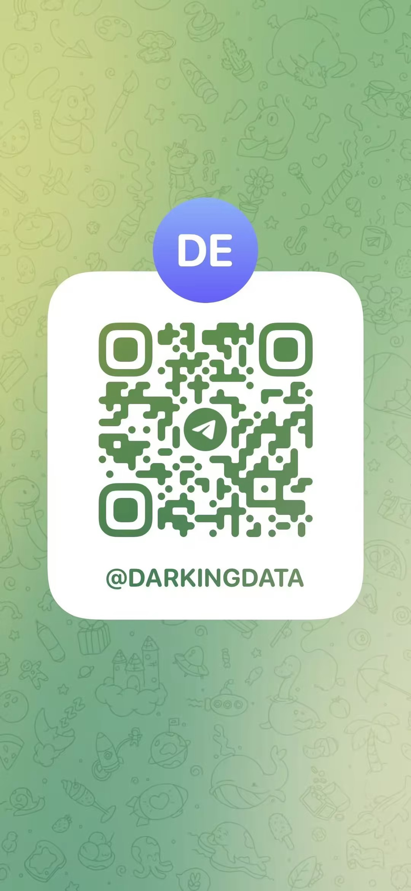

# Contact Edward / 联系 Edward

Edward Aming · CTO, **Smaroot / 慧根智研** · Beijing, China

For application fixes, API/CRM integration, business systems and AI workflows, start with one sentence: **what triggers the workflow, and what should happen next?**

| Channel | Contact |
|---|---|
| WhatsApp | Available on request through Telegram or email / 按需私下交换，不在此公开号码 |
| Telegram | [@DARKINGDATA](https://t.me/DARKINGDATA) |
| WeChat / 微信 | Scan Edward's QR code below / 扫描下方 Edward 微信二维码 |
| Company WeCom / 公司企微 | Edward · 慧根智研. Ask Edward for his company contact card via Telegram or business email / 可通过上述渠道获取公司企微名片 |
| Business email / 业务邮箱 | [edward@smaroot.tech](mailto:edward@smaroot.tech) |
| Company website | [smaroot.tech](https://www.smaroot.tech/?utm_source=github&utm_medium=github_contact&utm_campaign=software_services) |
| Company LinkedIn | [Smaroot](https://www.linkedin.com/company/smaroot-tech/) |

## WeChat — Edward

## Telegram — @DARKINGDATA

These contact cards were supplied by Edward for this business profile. If a QR code becomes unavailable, use the Telegram username, business email or our website.

[Back to profile](README.md) · [Engineering overview](ENGINEERING.md)
