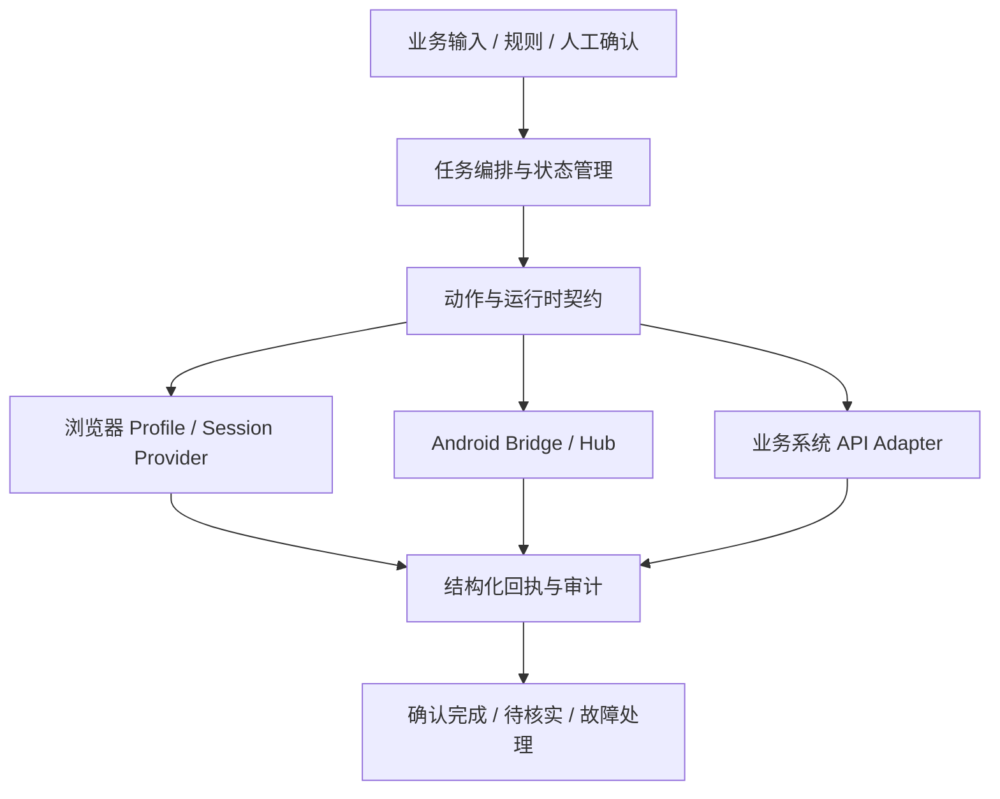

# Smaroot 自研产品与工程能力

**把业务输入变成可执行任务，再把执行结果变成可以核对的回执。** 这是我们自研自动化产品与定制业务系统中的共同工程问题。

## 产品与能力层次

| 自研方向 | 解决的问题 | 可公开查看 |
|---|---|---|
| 慧媒引擎 Huimei Engine | AI 内容运营、任务编排、业务动作适配与结果回传 | [产品介绍](https://www.smaroot.tech/products/huimei) |
| Matrix Browser | 长期浏览器 Profile、会话生命周期、自动化接入与操作可观测性 | [产品介绍](https://www.smaroot.tech/products/matrix-browser) |
| Matrix Mobile | Android Bridge、设备 Hub、Web 控制台与 MCP/REST 接入 | [产品介绍](https://www.smaroot.tech/products/matrix-mobile) |
| 绘影工坊 HuiYing Studio | AI 视频创作与制作流程组织 | [产品介绍](https://www.smaroot.tech/products/huiying) |
| 慧根商云 Smaroot Commerce | 商家经营与面向客户的业务流程 | [产品介绍](https://www.smaroot.tech/products/commerce) |

产品介绍展示各自定位；下面的代码仓库提供可以独立运行的工程组件。公开组件是单独编写的参考实现，未导出生产运行包、客户代码或私有配置。

## 一套任务，不同执行底座

下面是概念架构，帮助解释职责分工，并非产品部署拓扑。

### 1. 业务动作与浏览器底座分离

业务流程需要表达“打开页面、取得输入、提交操作、核对结果”，不应该把云端或本机浏览器的生命周期管理散落在每份脚本里。自研引擎中已有浏览器 Provider 选择、会话管理和 Action SDK 结果契约等实现。

对客户的价值是：更换执行底座或业务页面时，能更清楚地判断需要改动的是适配层、会话层还是业务规则。Profile 管理能力也不等于自研 Chromium 内核。

### 2. 崩溃恢复与幂等任务

最难处理的情况常常是：外部系统可能已经完成动作，本地却没有保存最后回执。自研 Local Worker 有任务认领、幂等键冲突检查、已完成结果复用与中断结果标为 unknown 的处理机制。

公开的 [`durable_jobs.py`](https://github.com/smaroot-tech-edward/smaroot-components/blob/main/durable_jobs.py) 采用独立 SQLite 实现展示这个问题：租约过期会进入核实状态，而不是立即重跑。它同时检查同键异内容、租户隔离、执行归属和结果持久化。

### 3. 运行包和能力契约

自研 CLI 的运行包处理包含 Schema、签名、有效期与 Worker 能力兼容校验。公开的 [`runtime_contract.py`](https://github.com/smaroot-tech-edward/smaroot-components/blob/main/runtime_contract.py) 聚焦其中的**版本与能力匹配**：只选择声明就绪、主版本相同且具备必要能力的 Provider。

该公开模块不包含生产签名格式或密钥，也不把能力匹配宣称为签名验证、权限验证或设备证明。

### 4. 回执语义直接影响业务判断

| 回执 | 可以说明什么 | 下一步 |
|---|---|---|
| submitted | 已提交或进入队列 | 继续核对外部系统结果 |
| confirmed | 适配器核实了业务结果并取得对应证据 | 记录完成及验收依据 |
| failed | 已观察到失败 | 按实际故障设计后续动作 |
| unknown | 最后结果不确定 | 先核外部状态，避免重复执行 |

因此，我们不会把按钮点击、HTTP 接受或 SDK 返回单独当作业务交付完成。

## 可以亲自验证的材料

- [Smaroot Components](https://github.com/smaroot-tech-edward/smaroot-components)：任务账本、运行时契约、离线示例、12 项行为检查及架构说明。
- [Webhook 幂等案例](https://github.com/smaroot-tech-edward/webhook-idempotency-demo)：表单到 CRM 的重复提交、冲突和必填字段处理。
- [公司产品目录](https://www.smaroot.tech/products)：自研产品定位与业务场景。

这些材料可用于评估我们的设计方法和代码实现。公开组件中的检查使用本地虚构数据，不代表对所有外部平台、分布式负载或客户生产环境的验收。

## 把能力映射到你的需求

如果你遇到重复 CRM 数据、任务中断后重复执行、浏览器会话难维护、不同执行端版本不兼容或 AI 流程缺少人工确认，可以先用一句话说明**触发条件 → 期望结果**。我们会按现有系统约束确定可独立验收的交付范围。

[联系 Edward](CONTACT.md) · [公司官网](https://www.smaroot.tech/)
